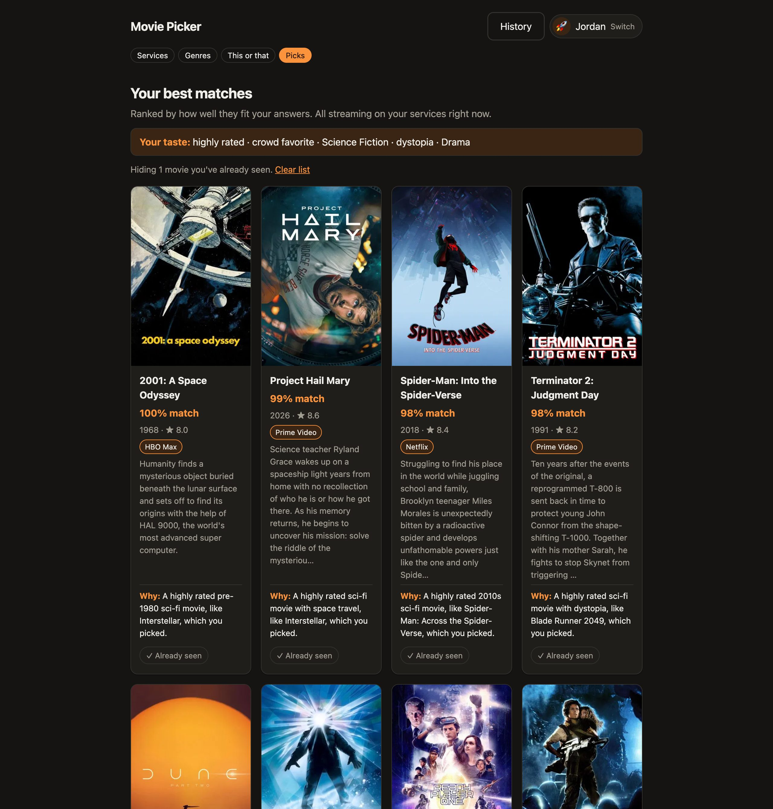
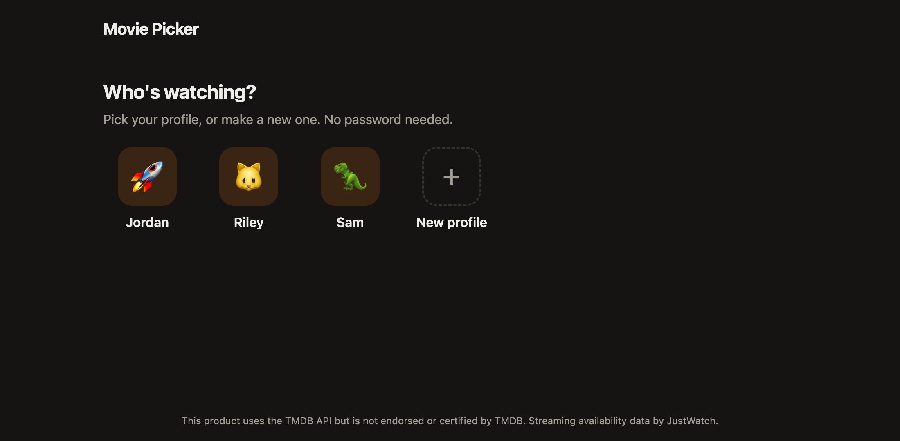
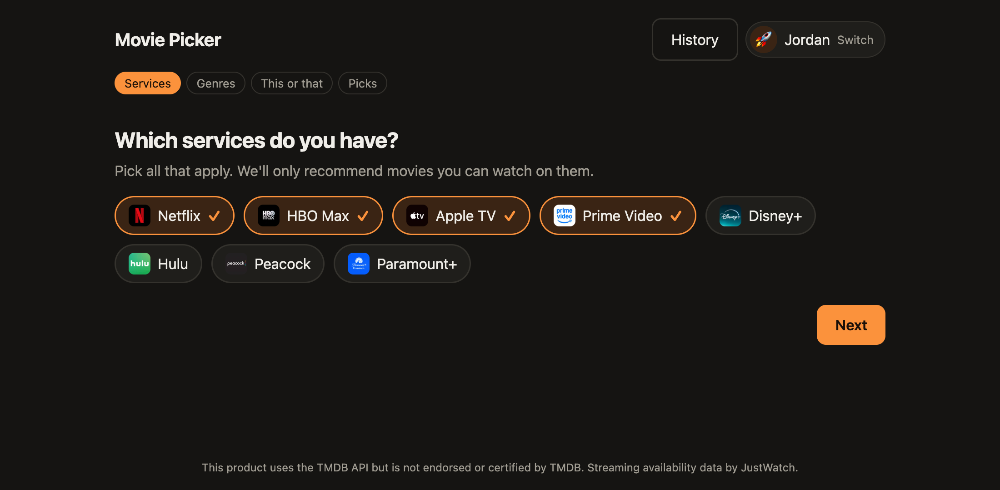
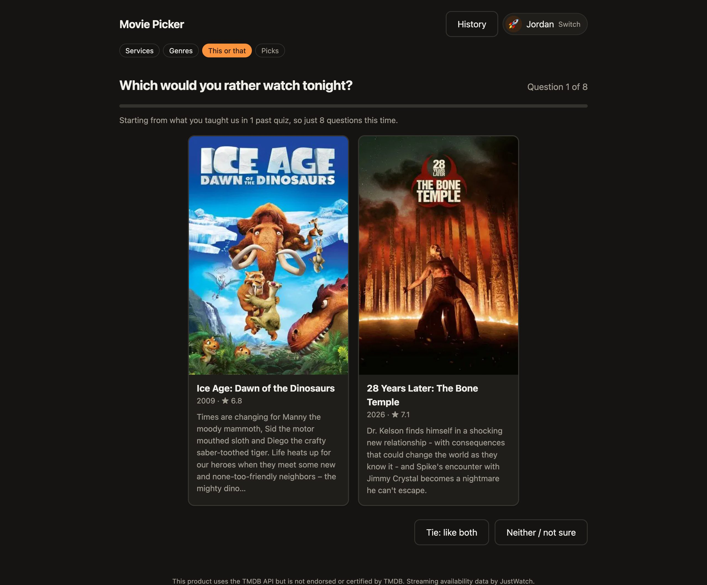
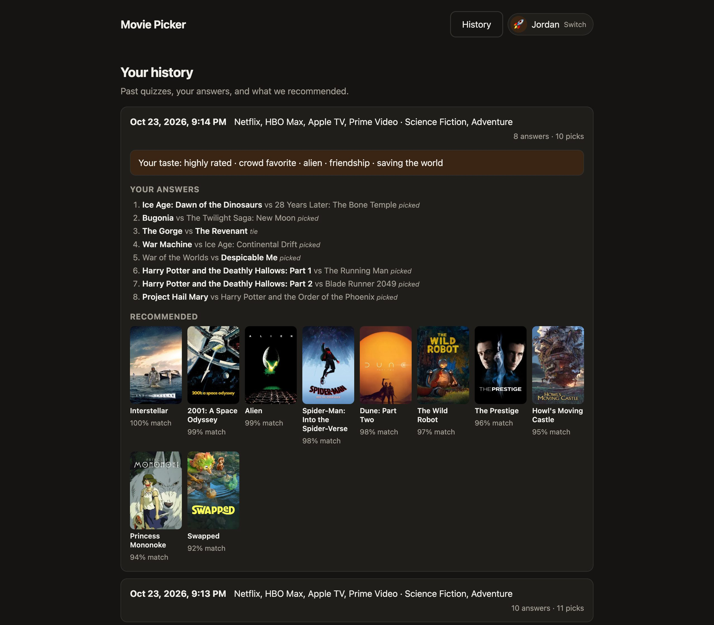
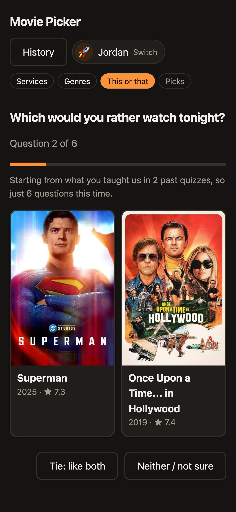

# Stream Search + Movie Picker

**"What should I watch tonight, and where can I watch it?"**

This repo has two pieces that work together:

| | What it is | How you use it |
|---|---|---|
| **[`stream-search/`](stream-search/)** | A [Claude Code](https://claude.com/claude-code) **skill** | Ask Claude streaming questions in plain English: *"where can I watch Severance?"*, *"good sci-fi on HBO Max?"*, *"what should I watch tonight?"* |
| **[`movie-picker/`](movie-picker/)** | A small **web app** | Answer 5–10 *"which would you rather watch?"* questions and get movies matched to your taste, available on the services you already pay for |

The skill can **start the app for you** and **read your app profile** (taste, liked and seen movies, past recommendations) to personalize its answers.

<p align="center">
  
</p>

Movie and streaming data comes from [TMDB](https://www.themoviedb.org/), which gets its streaming availability from [JustWatch](https://www.justwatch.com/).

> **Is this "AI"?** The **skill** runs on Claude: Claude reads the skill's instructions, calls its scripts for data, and writes the answer. The **web app makes no LLM calls at all**. Its recommendations come from a small, transparent taste model (vectors and pairwise comparisons), so it's free, fast and runs entirely on your machine.

**Contents**

- [Part 1: Using the skill and the app](#part-1-using-the-skill-and-the-app)
  - [What it can do](#what-it-can-do)
  - [Requirements](#requirements)
  - [Install](#install)
  - [Using the skill](#using-the-skill)
  - [Using the app](#using-the-app)
  - [Your data and privacy](#your-data-and-privacy)
  - [Troubleshooting](#troubleshooting)
  - [Known limitations](#known-limitations)
- [Part 2: Developing](#part-2-developing)
  - [Repository layout](#repository-layout)
  - [Architecture](#architecture)
  - [The web app](#the-web-app)
  - [The recommendation engine](#the-recommendation-engine)
  - [Data model](#data-model)
  - [HTTP API](#http-api)
  - [The skill](#the-skill)
  - [How the skill and the app communicate](#how-the-skill-and-the-app-communicate)
  - [Development workflow](#development-workflow)
  - [Recipes for common changes](#recipes-for-common-changes)
  - [Ideas and roadmap](#ideas-and-roadmap)
- [Credits](#credits)
- [License](#license)

---

# Part 1: Using the skill and the app

## What it can do

### The skill (in Claude Code)

| Capability | Example prompts | What you get |
|---|---|---|
| **Where to watch** | *"Where can I stream The Office?"*, *"Is Dune on Netflix?"* | Every US option, split into **subscription**, **free with ads**, **add-on channel** (e.g. HBO Max inside Prime Video), **live TV / cable**, and **rent / buy**. For TV shows it checks every season, because seasons are often split across services. It also catches same-name titles ("Dune 2021 or 1984?"). |
| **Browse a service** | *"Good sci-fi movies on HBO Max?"*, *"90s comedies on Netflix"* | 8–12 picks that are on that service right now, each with year and a one-line hook |
| **New and leaving** | *"What's leaving Netflix this month?"*, *"New on Apple TV in November"* | Titles listed by date, with the last day to watch first |
| **Personal recommendations** | *"What should I watch tonight?"*, *"Anything good for me on Prime?"* | Picks based on your Movie Picker profile: your services and taste, skipping movies you've marked as seen, each explained ("you liked Ponyo in your quiz") |
| **Your taste and history** | *"What kind of movies do I like?"*, *"What did the app recommend me last time?"* | A summary of your saved quizzes, liked movies and recommendations |
| **Run the app** | *"Open the movie picker"*, *"Stop the movie picker"* | Starts the web app in the background and gives you the link, or stops it |

Other countries work too: *"Where can I watch Bluey in the UK?"* Every answer ends with its source and the date it was checked, because streaming catalogs change every month.

### The web app (Movie Picker)

<table>
  <tr>
    <td width="50%"><br><sub><b>1. Who's watching?</b> Profiles with a name and an icon, no password</sub></td>
    <td width="50%"><br><sub><b>2. Your services</b>, remembered per profile</sub></td>
  </tr>
  <tr>
    <td><br><sub><b>4. This or that.</b> Contrasting pairs teach the most. After one quiz the app needs only 8 questions</sub></td>
    <td><br><sub><b>6. History:</b> every quiz, your answers and what was recommended</sub></td>
  </tr>
</table>

<p align="center">
  <br>
  <sub>Works on phones too</sub>
</p>

1. **Who's watching?** Pick or create a profile: a name and an emoji icon, no password.
2. **Your services:** Netflix, HBO Max, Apple TV, Prime Video, Disney+, Hulu, Peacock, Paramount+. They're remembered for next time.
3. **Your mood:** pick some genres, or none.
4. **This or that:** two movie posters at a time. Pick one, call it a **tie** (you'd happily watch either), or choose **neither / not sure**. You get 10 questions the first time, and as few as 5 once the app knows you.
5. **Your best matches:** 10 movies streaming on your services right now. Each card shows:
   - a **% match**
   - its plot summary
   - which of your services has it
   - one sentence on **why** it was picked, e.g. *"A 2000s animated family movie with anime, like Ponyo, which you picked."*

   From here you can:
   - **✓ Already seen** to hide a movie for good and pull in the next-best one
   - **Show more** to load the next 10
6. **History:** every past quiz, your answers and what was recommended.

The app **learns across quizzes**. Each new quiz starts from what your earlier answers taught it, even when you pick different services or genres. Untick *"Use what you've learned about me"* when you're in an unusual mood.

## Requirements

- **macOS or Linux.** Windows isn't supported yet (the skill's start/stop uses POSIX process groups).
- **[Claude Code](https://claude.com/claude-code)**, for the skill.
- **Python 3.9+** on your `PATH` as `python3`, for the skill's scripts. The macOS system Python works.
- **[uv](https://docs.astral.sh/uv/)**, for the web app. uv installs the Python 3.12 and packages the app needs on first run.
- **A free TMDB API key** (instructions below).

## Install

### 1. Get the code

```bash
git clone https://github.com/mollyyu/stream-searching-skill.git
cd stream-searching-skill
```

### 2. Get a TMDB API key, and keep it private

1. Create a free account at [themoviedb.org](https://www.themoviedb.org/signup).
2. Go to **Settings → API** and request an API key ("Developer", personal use).
3. Put it in your shell profile, **not in any file in this repo**:

   ```bash
   echo 'export TMDB_API_KEY=paste_your_key_here' >> ~/.zshrc   # or ~/.bashrc
   source ~/.zshrc
   ```

Either the short **API Key** (v3) or the long **API Read Access Token** (v4) works. For the token, use `TMDB_READ_ACCESS_TOKEN` instead.

> **🔒 Your key never belongs in this repository.** Both the skill and the app read it **only** from the environment variable. No config file holds it, and `.env` is git-ignored. If you fork the repo, `movie-picker/tests/test_no_secrets.py` fails the test run if your key ever shows up in a file git would commit. If a key does leak, regenerate it on TMDB's API settings page.

### 3. Install uv (for the web app)

```bash
curl -LsSf https://astral.sh/uv/install.sh | sh
```

### 4. Install the skill into Claude Code

Link (don't copy) the skill folder into Claude Code's skills directory:

```bash
ln -s "$PWD/stream-search" ~/.claude/skills/stream-search
```

**Why a link?** The skill finds the web app by following its own location back to this repo (`../movie-picker`). A link also means `git pull` updates the skill immediately. If you must copy it instead, set `MOVIE_PICKER_DIR=/path/to/stream-searching-skill/movie-picker` in your shell profile.

Restart Claude Code (or start a new session), and `stream-search` should appear in its skill list.

### 5. Check it works

```bash
python3 stream-search/scripts/tmdb.py where "The Office" --type tv      # TMDB key works
python3 stream-search/scripts/movie_picker.py start                     # app starts → http://localhost:8000
```

Then ask Claude Code: *"where can I watch The Office?"*

## Using the skill

You don't call the skill by name. Ask normally, and Claude Code uses it when your question is about streaming or the Movie Picker. Some examples:

```text
where can I watch the office? i want to rewatch from season 1
is dune on max or do I have to rent it
what are some good sci-fi movies on HBO Max right now
what's leaving netflix at the end of this month
open the movie picker
what should I watch tonight?          ← uses your Movie Picker profile
I'm Sam, anything good for me on Prime?
what kind of movies does Jordan like?
what did the app recommend me last time?
stop the movie picker
```

Here's what a typical answer looks like (illustrative):

```text
> where can I watch the office? i want to rewatch from season 1

The Office (US, 2005–2013, NBC) is streaming on Peacock, and all 9 seasons
are included with a subscription, so it's the one place for a full rewatch.

| How                    | Where                                                |
|------------------------|------------------------------------------------------|
| Subscription (S1–9)    | Peacock (Premium or Premium Plus)                    |
| Live TV / cable        | YouTube TV, TBS (some seasons only)                  |
| Buy                    | Prime Video, Apple TV Store, Google Play, Fandango   |

Streaming data from JustWatch via TMDB, checked Oct 21, 2026.
```

**How personal answers work:** Claude reads your profile. If there are several profiles, it asks who you are. It starts from your **unwatched past recommendations**, re-checks they're still on your services, adds fresh picks matched to your taste, and **never suggests anything you've marked as seen**. If you have no profile yet, it offers to open the app so you can take the quiz.

## Using the app

**Start it** by asking Claude *"open the movie picker"*, or by hand:

```bash
cd movie-picker
uv run uvicorn app.main:app          # → http://localhost:8000
```

**Tips**

- **Keyboard:** **←** / **→** pick a movie, **↑** = tie, **↓** = neither.
- **Tie or neither?** *Tie* means "I'd watch either", and the app learns what the two movies share. *Neither* teaches nothing, so use it when you haven't heard of either movie.
- **Short on time?** After question 5, **Show my picks now** skips the rest.
- **First quiz slow?** The first quiz for a new mix of services and genres takes about 5–10 seconds while the app downloads about 200 candidate movies. After that it's cached for an hour.
- **Mark what you've seen.** It's the quickest way to get better picks, and it carries over to every future quiz and to the skill.

## Your data and privacy

- **Everything stays on your machine,** in one SQLite file: `movie-picker/data/moviepicker.db`. The app has no accounts on any server, no analytics and no LLM calls.
- **What goes over the internet:** only requests to TMDB for movie data (genre filters, movie IDs, service IDs). Your profile name, answers and seen list are **never sent anywhere**.
- **Profiles have no passwords,** like Netflix profiles. Anyone who can open the app can pick any profile. That's fine for a household on one computer. The app listens on `127.0.0.1` (your machine only) by default. **Don't expose it to the internet as-is.**
- **The skill only reads your data.** It opens the database with writes disabled.
- **To erase everything,** stop the app and delete `movie-picker/data/`.

## Troubleshooting

| Problem | Fix |
|---|---|
| `TMDB_API_KEY is not set` | Add the export to `~/.zshrc` (step 2), then open a new terminal or restart Claude Code |
| `TMDB rejected the API key (401)` | Check the key for typos on TMDB's API settings page. A v4 token goes in `TMDB_READ_ACCESS_TOKEN` |
| `Port 8000 is used by another program` | `python3 stream-search/scripts/movie_picker.py start --port 8001` |
| `Not enough movies match` | Pick more services or another genre. Some combinations have very few titles |
| Claude doesn't use the skill | Check `ls -la ~/.claude/skills/stream-search` points at the repo, then start a new Claude Code session. Mentioning a service or "movie picker" helps |
| App won't start | Read `movie-picker/data/server.log`. Make sure `uv --version` works |
| Stop the app | Ask Claude *"stop the movie picker"*, or `python3 stream-search/scripts/movie_picker.py stop` |

## Known limitations

- **Availability lags.** TMDB/JustWatch data can be a few days behind real catalog changes. The skill double-checks surprising results with a web search.
- **The app is US-only and movies-only.** The skill handles TV shows and other countries.
- **No arrival/departure dates in TMDB,** so "new / leaving" answers come from web search and may be incomplete.
- **Taste is learned from your answers only,** so the first quiz is a rough sketch. More quizzes and "already seen" marks sharpen it.

---

# Part 2: Developing

## Repository layout

```
stream-searching-skill/
├── README.md                       ← you are here
├── LICENSE                         ← MIT
├── .gitignore                      ← keeps data, logs, venvs and secrets out of git
├── docs/screenshots/               ← images used in this README (demo profiles only)
│
├── stream-search/                  ── THE SKILL (runs inside Claude Code) ──
│   ├── SKILL.md                    instructions + trigger description Claude reads
│   ├── scripts/
│   │   ├── tmdb.py                 CLI: where-to-watch / browse via TMDB (stdlib only)
│   │   └── movie_picker.py         CLI: start/stop the app, read profiles (stdlib only)
│   └── evals/                      skill test cases (prompt + graders per case)
│
└── movie-picker/                   ── THE WEB APP ──
    ├── pyproject.toml / uv.lock    deps: fastapi, uvicorn, httpx (+ pytest for dev)
    ├── app/
    │   ├── main.py                 FastAPI routes, profiles, candidate pool, quiz flow
    │   ├── recommender.py          taste model: features, pair choice, learning, ranking (pure)
    │   ├── db.py                   SQLite schema, migrations, all queries
    │   └── tmdb.py                 async TMDB client with cache + rate-limit retry
    ├── static/                     index.html, app.js, style.css (no build step)
    ├── tests/                      pytest: API, recommender, skill bridge, secrets guard
    └── data/                       (git-ignored) moviepicker.db, server.log, server.pid
```

## Architecture

```
                      ┌────────────────────────────────────────────┐
                      │  TMDB API  (movie data; streaming          │
                      │            availability from JustWatch)    │
                      └────────────▲───────────────────▲───────────┘
                                   │ HTTPS             │ HTTPS
        ┌──────────────────────────┴──────┐   ┌────────┴─────────────────────────────┐
        │  stream-search  (skill)         │   │  movie-picker  (web app)             │
        │                                 │   │                                      │
        │  SKILL.md ──► Claude decides    │   │  browser (static/app.js)             │
        │               which tool to run │   │      │  fetch /api/*  (JSON)         │
        │                                 │   │      ▼                               │
        │  scripts/tmdb.py ───────────────┼───┘  app/main.py  (FastAPI)            │
        │                                 │       ├─ app/recommender.py (pure math)  │
        │  scripts/movie_picker.py        │       ├─ app/tmdb.py (async, cached)     │
        │    start/stop ──spawns──────────┼──────►├─ app/db.py ──► data/moviepicker.db
        │    status ──GET /api/health─────┼──────►│                       ▲          │
        │    profiles/profile ──read-only─┼───────┼───────────────────────┘          │
        └─────────────────────────────────┘       └──────────────────────────────────┘
```

**Design principles**

1. **The app owns the data; the skill only reads it.** All writes go through `app/db.py`. The skill opens the database with `PRAGMA query_only`.
2. **No shared code between the two halves.** Each has its own TMDB client: the skill's is a sync CLI that runs on the system Python, and the app's is an async, cached server client. The database schema is the contract between them, and a cross-project test guards it (see [communication](#how-the-skill-and-the-app-communicate)).
3. **Skill scripts are standard-library only and Python 3.9 compatible.** Claude runs them with whatever `python3` is on the user's `PATH`, so they can't depend on the app's virtualenv. Don't use `X | None` annotations or 3.10+ features there.
4. **The quiz endpoint is stateless.** The browser sends the whole answer history with each request and the server replays it. Restarts never lose a quiz in progress, and the same answers always produce the same next question. The database records answers for history and learning, but the quiz logic never depends on it.
5. **No LLM in the app.** Everything the app shows is computed and explainable. The skill is where language understanding lives.
6. **No build step.** The frontend is plain HTML, CSS and JS served by FastAPI.

## The web app

### Backend modules

| Module | Responsibility | Depends on |
|---|---|---|
| `app/main.py` | HTTP routes, profile cookie, building and caching the candidate **pool**, the quiz/recommendation flow, persisting answers and results | everything below |
| `app/recommender.py` | **Pure functions**: feature vectors, pair selection, learning updates, ranking, match %, "why" sentences. No I/O, which makes it easy to test | nothing |
| `app/db.py` | SQLite schema, lightweight migrations (`_migrate`), every SQL query | `sqlite3` |
| `app/tmdb.py` | Async `httpx` client: v3 key or v4 bearer auth, 6-hour in-memory cache, retry on HTTP 429, max 16 concurrent requests | `httpx` |

### Frontend

`static/app.js` is one script with a `state` object (`user`, `services`, `genres`, `quizId`, `history`, `pair`, `displayed`, `seen`) and one function per screen. `show(screen)` toggles the screens: `profiles → services → genres → quiz → results`, plus `history`. All server calls go through `api(path, {method, body})`, which also sends the user back to the profile picker on any `401`.

### Lifecycle of one quiz

```
browser                                  server (main.py)                         storage
───────                                  ────────────────                         ───────
GET  /api/me ───────────────────────────► read cookie mp_user ──────────────────► users
POST /api/quizzes {services, genres,  ──► create quiz row ──────────────────────► quizzes
                   use_history}
POST /api/next {history: []} ───────────► build_pool(services, genres)  (cached 1h)
                                            ├ TMDB /discover/movie × 10 pages ──► TMDB
                                            ├ TMDB /movie/{id}/keywords × ~200
                                            └ build_space + vectorize
                                          prior = replay(past answers × 0.5) ◄── answers, movies
                                          w = replay(history, start=prior)
                                          choose_pair(...) ◄── {pair, round, rounds, learned}
   … user answers; browser appends {a, b, choice} to history and repeats …
POST /api/next {history: [...]} ────────► save_movies + save_answers (idempotent) ► movies, answers
POST /api/next {finish: true} ──────────► recommend → TMDB /movie/{id}?append=watch/providers
                                          keep on-service, 1 per series, top 10
                                          save_recommendations ─────────────────► recommendations
                                       ◄── {taste, recommendations, more}
POST /api/me/seen [{movie_id,…}] ───────► add_seen ─────────────────────────────► seen
POST /api/next {finish, displayed, ─────► same ranking, excluding displayed + seen
                limit: 1 | 10}           (replacement card / "Show more")
```

## The recommendation engine

All of this is in `app/recommender.py`. The tuning constants are at the top of `recommender.py` and `main.py`.

**1. Candidate pool.** About 200 popular movies from TMDB `/discover/movie`, filtered by the user's providers (`with_watch_providers`, flatrate only), the chosen genres (OR) and `vote_count ≥ 150`, plus each movie's TMDB keywords. The pool is cached per (services, genres) for 1 hour.

**2. Feature space.** `build_space(pool)` fixes the layout, and `vectorize(movie, space)` turns *any* movie into a unit vector:

| Features | Encoding |
|---|---|
| genres in the pool | one-hot, 1.0 |
| era: pre-1980, 1980s … 2020s | one-hot, 1.0 |
| popularity | z-score of log(popularity), clipped to ±1 |
| acclaim | z-score of TMDB rating, clipped to ±1 |
| top 60 keywords appearing in 3+ pool movies (minus generic ones like "sequel") | 0.7 each |

Splitting `build_space` from `vectorize` is what lets past answers about movies **outside** tonight's pool still count.

**3. Choosing a pair (the "binary search").** For a candidate pair (A, B), the hyperplane halfway between them splits the shortlist into "closer to A" and "closer to B". Each round picks the pair that maximizes:

```
balance (how evenly it splits, 0–1) × distinctness ‖A−B‖ × uncertainty 1/(1+|w·(A−B)|)
```

The shortlist narrows each round to the best-scoring 80%ʳᵒᵘⁿᵈ of candidates (at least 24). Shown movies come from the more popular 60% and, when possible, from the last 20 years (`QUESTION_MAX_AGE`), so people recognize them.

**4. Learning.** The taste vector `w` gets a Bradley–Terry update per answer:

| Answer | Update |
|---|---|
| pick A over B | `w += lr · (1 − σ(w·(A−B))) · (A−B)` |
| tie | same, with "average of A and B" beating the pool centroid, at `lr × 0.5` |
| neither | no update |

**5. Past quizzes.** `_prior()` replays the user's last 50 non-skip answers from *other* quizzes at `lr = 0.5`, using saved movie details (`movies` table) for movies not in tonight's pool. The question count drops with history: `10` under 10 past answers, then `max(5, 10 − answers // 4)`.

**6. Ranking results.**
- **Score:** `score = w·x + 0.15 × (rating − 6.5)`.
- **Diversity:** maximal marginal relevance with weight 0.15.
- **Availability and series:** the top 40 are checked with one TMDB request each (`/movie/{id}?append_to_response=watch/providers`). Only movies on the user's services stay, at most **one per series** (TMDB collection).
- **Match %:** the movie's percentile among all non-quiz movies in the pool.

**7. Explanations.**
- `explain()`: top features where *both* `wᵢ > 0` and `xᵢ > 0`.
- `why_sentence()`: a template built from those features, plus the most similar movie the user picked (cosine > 0.4).
- `taste_summary()`: the user's strongest positive weights.

## Data model

SQLite at `movie-picker/data/moviepicker.db`, or `$MOVIE_PICKER_DB` if set. It uses WAL mode with foreign keys on, and columns marked JSON hold JSON text.

```
users 1───* quizzes 1───* answers
  │            └───────* recommendations
  └───* seen
movies   (shared cache of compared movies, keyed by TMDB id)
```

| Table | Columns | Notes |
|---|---|---|
| `users` | `id`, `name` (unique, case-insensitive), `icon`, `services` JSON, `created_at` | `services` = last-used service keys, e.g. `["netflix","hbomax"]` |
| `quizzes` | `id`, `user_id`, `services` JSON, `genres` JSON `[{id,name}]`, `taste` JSON, `use_history`, `started_at`, `finished_at` | `taste` and `finished_at` are set when results are first shown |
| `answers` | PK (`quiz_id`, `round`), `movie_a`, `title_a`, `movie_b`, `title_b`, `choice` ∈ `a b tie skip`, `answered_at` | Insert-or-ignore, so resending the whole history is safe |
| `recommendations` | PK (`quiz_id`, `movie_id`), `title`, `year`, `poster`, `match`, `why`, `services` JSON, `shown_at` | Includes "Show more" and replacement cards |
| `seen` | PK (`user_id`, `movie_id`), `title`, `poster`, `marked_at` | Never recommended again, by the app or the skill |
| `movies` | `id` (TMDB), `title`, `year`, `genre_ids` JSON, `keywords` JSON, `popularity`, `rating`, `poster`, `updated_at` | Lets past answers be re-vectorized in a new pool's feature space |

**Migrations:** `CREATE TABLE IF NOT EXISTS` handles new tables. New columns on existing tables go in `DB._migrate()` (check `PRAGMA table_info`, then `ALTER TABLE … ADD COLUMN`) so existing users' files upgrade on startup.

## HTTP API

All JSON. The profile is identified by the `mp_user` cookie (HTTP-only, SameSite=Lax), and endpoints under `/api/me`, `/api/quizzes` and `/api/next` return `401` without it.

| Method | Path | Body → Response |
|---|---|---|
| GET | `/api/health` | → `{ok, app: "movie-picker"}`, used by the skill to identify the server |
| GET | `/api/users` | → `{users: [{id,name,icon}], icons: [...]}` |
| POST | `/api/users` | `{name, icon}` → user, sets the cookie. `409` if the name is taken, `422` for a bad icon |
| POST | `/api/login` | `{user_id}` → user, sets the cookie |
| POST | `/api/logout` | → `204`, clears the cookie |
| GET | `/api/me` | → `{id, name, icon, services, past_answers}` |
| GET | `/api/me/history` | → last 20 quizzes with `answers` and `recommendations` |
| GET / POST / DELETE | `/api/me/seen` | list / add `[{movie_id, title?, poster?}]` / clear all |
| DELETE | `/api/me/seen/{movie_id}` | un-mark one movie |
| GET | `/api/services` | → `[{key, name, logo}]` (the 8 supported services) |
| GET | `/api/genres` | → `[{id, name}]` |
| POST | `/api/quizzes` | `{services, genres, use_history}` → `{quiz_id}` |
| POST | `/api/next` | `{services, genres, history: [{a,b,choice}], quiz_id?, finish?, displayed?, limit?}` → **either** `{done: false, round, rounds, learned: {quizzes, answers}, pair: [card, card]}` **or** `{done: true, taste, recommendations: [card + match, why, reasons, services], more}` |

TMDB problems (missing or bad key, outage) come back as `503 {detail}` with a readable message.

## The skill

### `SKILL.md`

- **Frontmatter `description`:** the only part Claude sees *before* deciding to use the skill, so it lists trigger phrases on purpose ("where can I watch", "what's leaving", "movie picker", "what should I watch tonight"…). Change it carefully: it decides when the skill fires.
- **Body:** loaded once the skill triggers. It covers:
  - defaults (US region, date the answer)
  - how to call each script
  - service-name aliases (Max ⇄ HBO Max, Apple TV ⇄ Apple TV+, Prime add-on channels, live-TV providers)
  - **three modes:** where to watch, browse a service, new/leaving
  - the **Movie Picker** section: when to start the app, how to personalize
  - answer format, with a mandatory source and date line
  - things to avoid

### `scripts/tmdb.py`

Synchronous CLI, standard library only, JSON output. Commands:
- `where` (search + availability + `other_matches`, `--seasons` per season)
- `providers`
- `discover` (`--service` accepts aliases and comma lists; service tiers like "Paramount+ Premium/Essential" are merged; add-on channels and stores are excluded unless named)
- `search`, `services`, `genres`

It reads `TMDB_API_KEY` / `TMDB_READ_ACCESS_TOKEN` from the environment.

### `scripts/movie_picker.py`

The bridge to the app. See the next section.

### `evals/`

One folder per test case: `prompt.md`, `case.yaml` and `graders/` with one checkable statement per file. They're used to compare Claude with and without the skill (the layout `claude plugin eval` reads). The first round: with the skill, 93% of checks passed; without it, 60%. The baseline recommended three HBO Max movies that weren't actually on HBO Max.

## How the skill and the app communicate

They talk through **three narrow channels**. Nothing else is shared.

### 1. Process control: start / status / stop

```
movie_picker.py start [--port 8000]
  1. GET http://127.0.0.1:{port}/api/health
       {"app":"movie-picker"}  → already running: return the URL
       anything else answers   → "port used by another program"
       nothing answers         → continue
  2. check TMDB_API_KEY is set, find uv
  3. spawn `uv run uvicorn app.main:app --port {port}`
       cwd = movie-picker/, new session (start_new_session=True), so it outlives the script
       stdout/stderr → movie-picker/data/server.log
       write "{pid} {port}" → movie-picker/data/server.pid
  4. poll /api/health until it answers (≤ 90s; the first run installs dependencies)
       → {"running": true, "started": true, "url": "http://localhost:{port}"}

movie_picker.py stop   → killpg(pid, SIGTERM): stops uv and uvicorn together, removes the pid file
movie_picker.py status → health + pid file + database info
```

`/api/health` exists so the skill never mistakes another program on the port for the app.

### 2. Data: read-only access to the SQLite file

`profiles` and `profile NAME` **read the database file directly**. They don't call the HTTP API, for three reasons:

- **It works when the app isn't running.** Claude can answer "what's my taste?" without starting a server.
- **No login needed.** The API identifies users by cookie. The skill needs every profile, by name.
- **It can't corrupt anything.** The connection sets `PRAGMA query_only = ON`. It deliberately doesn't use `mode=ro`, because a read-only connection can't create the WAL shared-memory file when the app is stopped, and that fails on the system Python.

What `profile NAME` returns (shape, abbreviated):

```json
{
  "profile":   {"name": "…", "icon": "🍿", "services": ["netflix", "hbomax"], "created_at": "…"},
  "overall_taste": ["2000s", "Animation", "Family", "Comedy"],
  "totals":    {"quizzes": 1, "liked_movies": 9, "seen": 0, "recommended": 30},
  "recent_quizzes":   [{"date": "…", "services": […], "genres": […], "taste": […],
                        "used_past_answers": true, "answers": 10, "choices": {"a": 4, "b": 5, "skip": 1}}],
  "liked_in_quizzes": [{"id": 12429, "title": "Ponyo", "how": "picked"}],
  "seen":             [{"id": 11, "title": "…", "marked_at": "…"}],
  "recommendations":  [{"id": 129, "title": "Spirited Away", "year": 2001, "match": 97,
                        "why": "…", "services": ["HBO Max"], "recommended_on": "…", "seen": false}]
}
```

- `overall_taste`: the most frequent tags across all quizzes.
- `liked_in_quizzes`: movies picked or tied, newest first.
- `recommendations`: one entry per movie, **unseen first**, then newest quiz and best match.

### 3. Locating each other

| Setting | Default | Override |
|---|---|---|
| App folder | `<real path of movie_picker.py>/../../movie-picker` | `MOVIE_PICKER_DIR` |
| Database | `<app folder>/data/moviepicker.db` | `MOVIE_PICKER_DB` (the app reads the same variable) |
| Port | `8000` | `--port` |

The script resolves its own real path, which is why installing the skill as a **symlink** finds the repo automatically.

### Example: "what should I watch tonight?"

```
User ─► Claude: "what should I watch tonight?"
Claude: description matches → loads SKILL.md → follows "When the user wants something personal"
  1. movie_picker.py profiles            → 2 profiles → asks "who's watching, Jordan or Sam?"
  2. movie_picker.py profile Jordan      → services, taste, seen, unseen recommendations
  3. tmdb.py where "Spirited Away" …     → re-check the top picks are still on Jordan's services
  4. tmdb.py discover --service "netflix,hbomax,…" --genre animation   (if more are needed)
  5. answer: picks minus `seen`, explained with Jordan's own quiz picks, plus a link to retake the quiz
```

### Keeping the contract intact

**`movie-picker/tests/test_skill_bridge.py`** builds a database with the app's own `DB` class, then runs `movie_picker.py` as a subprocess on the test Python **and** on `/usr/bin/python3` if present (macOS 3.9), and checks:
- `profiles` counts
- `profile` content and ordering
- unknown-profile errors
- that reading never changes the file
- `status`

> **Rule:** if you change a table the skill reads (`users`, `quizzes`, `answers`, `recommendations`, `seen`), update `stream-search/scripts/movie_picker.py` in the same change. The bridge test will tell you if you forgot.

## Development workflow

### Setup

```bash
git clone … && cd stream-searching-skill
export TMDB_API_KEY=…                      # in your shell profile, never in a file here
cd movie-picker
uv sync                                    # creates .venv with Python 3.12 + deps
uv run uvicorn app.main:app --reload       # http://localhost:8000, reloads on save
```

Use a scratch database while developing, so you don't touch your real profiles:

```bash
MOVIE_PICKER_DB=/tmp/mp-dev.db uv run uvicorn app.main:app --reload --port 8001
```

### Tests

```bash
cd movie-picker
uv run pytest            # ~50 tests, about 3 seconds
```

| File | Covers |
|---|---|
| `test_recommender.py` | Simulated users (a sci-fi fan should get ≥ 8/10 sci-fi), pair rules, ties, past-answer priors, explanations |
| `test_api.py` | Every endpoint against a **fake TMDB**, so no key or network is needed: quiz flow, paging, seen, profiles, history, ownership checks, learning across quizzes, database migration |
| `test_skill_bridge.py` | The skill ↔ app contract (above) |
| `test_no_secrets.py` | Fails if the `TMDB_API_KEY` in your environment appears in any file git would commit, and checks that data, logs and `.env` are git-ignored |

**Run the tests before every commit.** The secrets test only protects you if it runs.

### Testing the skill

- **Scripts:** run them directly, e.g. `python3 stream-search/scripts/tmdb.py discover --service max --genre sci-fi`.
- **Behavior:** start a new Claude Code session and ask real questions.
- **Systematically:** the cases in `stream-search/evals/` work with the `skill-creator` skill's eval loop, or with `claude plugin eval` (Claude Code 2.1.269+) from the `stream-search/` folder. These make real model calls.

### Conventions

- Match the surrounding style: small functions, comments that explain *why*.
- `recommender.py` stays pure (no I/O). Pass data in.
- Skill scripts: **standard library only, Python 3.9 compatible**, JSON on stdout, `{"error": "…"}` with exit code 1 on failure.
- Frontend: no frameworks, no build step. Set user-provided text with `textContent`, never `innerHTML`.
- **Secrets:** read keys only from environment variables. Never log request URLs that carry `api_key`. Never commit `.env` or `movie-picker/data/`.

## Recipes for common changes

**Add a streaming service to the app.** Add `(key, label, tmdb_name_prefix)` to `SERVICES` in `app/main.py`. The prefix matches all of TMDB's tier entries ("Paramount Plus Premium", "… Essential"), and add-on channels and stores are excluded automatically. Then add the alias to `SERVICE_ALIASES` in `stream-search/scripts/tmdb.py` and to the alias list in `SKILL.md`.

**Add a column or table.** New table: add it to `SCHEMA` in `db.py`. New column on an existing table: also add it to `_migrate()`. If the skill should see it, update `profile()` in `movie_picker.py` and extend `test_skill_bridge.py`.

**Change how many questions are asked.** Change `ROUNDS`, `MIN_ROUNDS` and `_rounds()` in `main.py`. The frontend reads `rounds` from each response.

**Tune recommendations.**
- `QUALITY_WEIGHT` and `TIE_WEIGHT` in `recommender.py`.
- `diversity=` in `recommend()`.
- `PAST_WEIGHT`, `PAST_LIMIT`, `QUESTION_MAX_AGE` and `RESULT_CANDIDATES` in `main.py`.

Then run `test_recommender.py`, and try a few real quizzes on a scratch database.

**Add a skill command.** Add a subcommand to the relevant script (keep it 3.9-compatible), document it in the command table in `SKILL.md`, and say *when* Claude should use it. Without that, Claude won't know to use it.

## Ideas and roadmap

- TV shows in the app (the skill already handles them)
- Regions other than the US in the app (`REGION` in `main.py`)
- Older quizzes counting less than recent ones
- "Dislike both" as a separate answer from "haven't seen them"
- Optional LLM features in the app (natural "why" sentences, a free-text mood box), behind a setting
- Windows support for the skill's start/stop
- Optional passwords if the app is ever hosted

## Credits

- Movie metadata and images from **[TMDB](https://www.themoviedb.org/)**. *This product uses the TMDB API but is not endorsed or certified by TMDB.*
- Streaming availability data from **[JustWatch](https://www.justwatch.com/)**, via TMDB.
- The skill runs on **[Claude Code](https://claude.com/claude-code)**.

## License

[MIT](LICENSE) © 2026 Molly Yu. Movie data and images belong to their owners and are used through the TMDB API under [TMDB's terms](https://www.themoviedb.org/api-terms-of-use).
